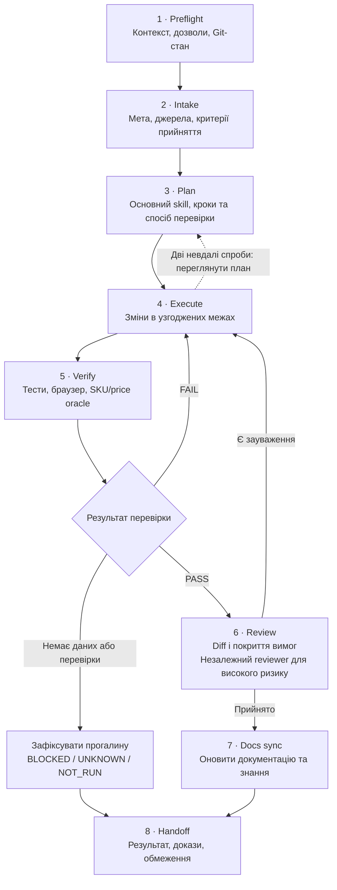
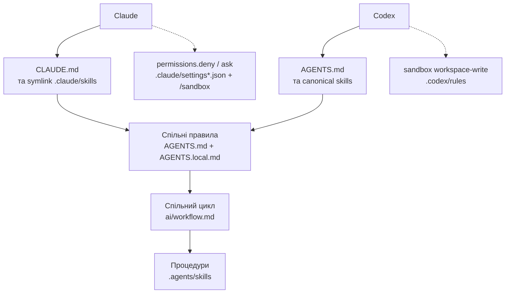

# Схеми AI workflow Hastings UI

Підтримуване візуальне пояснення [спільного workflow](workflow.md).
Власником правил залишається `ai/workflow.md`; процедури належать канонічним skills,
а межі дій задають вбудовані дозволи рантаймів (`.claude/settings*.json`, sandbox Codex).

## Цикл реалізації

Цей цикл стосується задач зі зміною коду Hastings UI.

Для планування результатом є план; для рев’ю — висновки без редагування коду.
Невідому причину помилки спочатку досліджує `local-debug-root-cause`.
Один наявний план або checkpoint зберігає стан задачі; SDD підключається за потреби.

`BLOCKED`, `UNKNOWN` і `NOT_RUN` залишають критерій непідтвердженим: handoff фіксує
прогалину та відповідального, а не означає успішне завершення. Зелені тести не
замінюють потрібної браузерної перевірки; очікувані SKU й ціни потребують незалежного oracle.

## Адаптери та дозволи

Claude та Codex використовують спільні правила й процедури.

Дозволи рантаймів — єдиний жорсткий шар: текст у `AGENTS.md` — інструкція, правило в
`permissions.deny` чи sandbox — заборона, яку модель не може проігнорувати.

Поточний режим пілоту — без commit, push і deploy. Handoff не запускає доставку.
