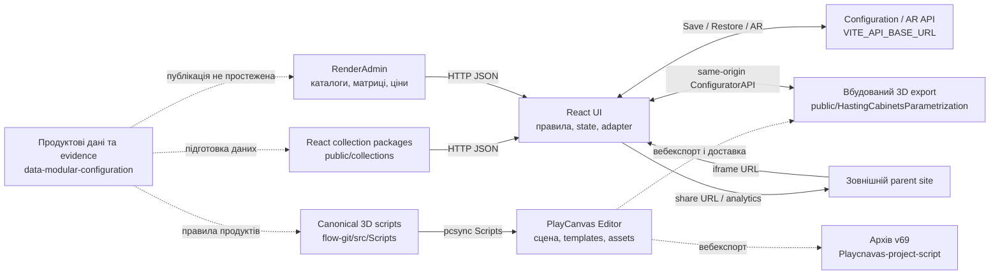
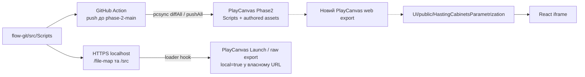

# Карта екосистеми Hastings Modular Configurator

Знімок локального стану на **22 жовтня 2026 року**. Дослідження виконали основний агент і три спеціалізовані агенти: React та міжсистемні зв'язки; canonical PlayCanvas; архів сцени; продуктові дані. Твердження нижче стосуються перевірених файлів, включно з незакоміченими змінами. Відповідність production deployment локальним checkout не перевірялася.

## 0. Місце Modular у HASTINGS-SOLUTIONS

Уточнення власника проєкту від 2026-10-22: `HASTINGS-SOLUTIONS` є спільним робочим каталогом портфеля Hastings. У ньому три напрями реалізації та окрема база продуктових знань. Ця карта детально досліджує Modular і його використання даних; AI та 2D нижче позначені для визначення меж.

| Напрям / спільна частина | Поточні папки | Призначення |
|---|---|---|
| AI Configurator | `AI-Agent/` | Агент, який допомагає користувачеві конфігурувати продукти; локально є `llm-model/` і `POC-v0/`. README POC описує клієнт Socket.IO для product configuration і style recommendations. |
| 2D Configurator | `HASTING-2D-RENDER-PLAYER/`, `2d-test-product/` | Окремий напрям із 2D/Threekit rendering; `fast-compositor-check` — його засіб перевірки. Власник визначив цей напрям незалежним від PlayCanvas. |
| Modular / PlayCanvas | `MODULAR/` | React UI, canonical 3D source, web exports, QA та граф залежностей модульного конфігуратора. |
| Спільні продуктові знання | `data-modular-configuration/` | Вхідні матеріали, аналіз продуктів, конфігураційні правила, edge cases та невизначеності. Зараз значна частина матеріалів стосується Modular; за призначенням база також може обслуговувати AI і 2D. |

Спільність продуктових знань не доводить наявності автоматичної інтеграції data repo з кожним застосунком. Загальні факти про продукт, правила конкретної колекції та mappings/обмеження окремого renderer мають зберігати власну область застосування й посилання на джерела.

Рекомендована організація контексту: коротка нейтральна карта всього портфеля на рівні `HASTINGS-SOLUTIONS`; продуктові знання — в data repo; міжрепозиторний технічний контекст Modular — на рівні `MODULAR`; деталі реалізації — у відповідному code repo. Кореневий `claude/project-map.md` зараз описує лише Modular. Наявний `MODULAR/ARCHITECTURE-MAP.md` є згенерованим digest графа залежностей і має власний спосіб оновлення.

Структура каталогів перевірена локально. Призначення напрямів уточнене власником; AI/2D код не проходив таке саме детальне дослідження, як чотири папки попереднього огляду. На 2026-10-22 створені підтримувані точки входу: [карта HASTINGS-SOLUTIONS](../../../PROJECT-MAP.md) та [карта MODULAR](../../PROJECT-MAP.md), пов’язані з локальними документами через `AGENTS.md`. Папки залишаються на місці; цей документ зберігає статус датованого результату дослідження.

## 1. Ролі чотирьох робочих папок

| Робоча папка | Відповідальність | Що передає далі |
|---|---|---|
| `UI-APP-config-react` | Застосунок користувача: колекції, навігація, UI, перевірка вибору, Redux, переклад команд у 3D, SKU/quote, Save/Restore, Share, AR. Також містить статичний PlayCanvas export у `public/`. | Команди й дані конфігурації в 3D; HTTP-запити по каталоги, ціни та збереження; share URL й аналітика для parent site. |
| `hasting-modular-playcanvas-flow-git` | Оболонка локальної розробки та інструменти. **Canonical PlayCanvas source — окремий вкладений Git checkout `src/`**, насамперед `src/Scripts/`. | Browser-compatible scripts у PlayCanvas Editor через sync; локальні скрипти для dev-підміни; публічний `window.ConfiguratorAPI` всередині runtime. |
| `Playcnavas-project-script` | Розпакований контрольний вебекспорт **`Hasting-phase-2-stage-v69`**, індекси й інструменти дослідження сцени/templates/assets. Коренева папка не є Git checkout. | Факти про конкретний build: scene, asset registry, templates, bundled scripts. Використовується для аналізу та звірки. |
| `data-modular-configuration` | Продуктова база знань: Master Files, специфікації, клієнтські уточнення, матриці, прайси, snapshots backend, дослідження та підготовлені матеріали для інтеграції. | Дані й рішення для підготовки collection packages, backend tables, SKU rules та PlayCanvas product rules. Прямого runtime-імпорту з цієї папки у React не знайдено; спосіб публікації backend records не встановлений. |

Тут немає одного універсального «джерела істини». Комерційна специфікація, завантажений пакет колекції, актуальний 3D-код, assets конкретного build і стан поточної сцени належать різним шарам.

### Ідентичність перевірених checkout

| Частина | Branch | HEAD | Початковий стан |
|---|---|---|---|
| React UI | `package-3/fix` | `91257118` | Незакомічені зміни |
| PlayCanvas dev wrapper | `phase-2-main-deploy` | `034e867` | Незакомічені зміни |
| Вкладений canonical `src/` | `feture/part-2` | `5310d1f` | Незакомічені зміни |
| Data root | `analysis/products-data` | `53ec342` | Незакомічені зміни |
| Data: вкладений `Urban Standard Height/` | `main` | `cb794e0` | Незакомічені зміни |
| Архів v69 | — | — | Versioned export за fingerprint, без Git metadata |

Branch/HEAD ідентифікують базу checkout, але не повністю описують досліджений dirty working tree. У wrapper і data root вкладені дерева зареєстровані як Git links: їхній власний стан треба перевіряти окремо.

## 2. Загальна схема

Суцільні стрілки — підтверджені виконувані зв'язки. Пунктир — підготовка, публікація або походження артефакту, для яких немає підтвердженого наскрізного автоматичного pipeline в цих чотирьох папках.



Архів v69 та export у React — **два різні знімки**. Схема не стверджує, що поточна UI-копія була скопійована саме з наявного v69. Зовнішні parent site, RenderAdmin, Configuration/AR backend і стан PlayCanvas Editor не входять до цих чотирьох локальних папок.

## 3. React: від пакета колекції до сцени

Стек за `package.json`: React 18.3.1, TypeScript, Vite, Redux Toolkit/RTK Query, React Router, Zod; стилі — переважно SCSS modules. Структура `app → pages/widgets → features → entities/shared`; поряд залишаються інтеграційні helpers у `utils/functions/playcanvas`.

| Шар | Основні файли / каталоги | Роль |
|---|---|---|
| Composition root | `src/main.tsx`, `src/app/router`, `src/app/store` | Монтування React, store, маршрути та gate готовності колекції. |
| Колекції | `src/entities/collection`, `public/collections` | Registry, manifest, локальні JSON, remote sources, валідація й нормалізація. |
| Продукт і стан | `src/entities/product`, `src/entities/configuration` | Доступні шафи/розміри, вибрані значення, stable identity, синхронізація з runtime. |
| Дії користувача | `src/features/configurationCommands`, `configurator-rule-core` | Перевірка допустимості, побічні зміни, підтвердження, застосування і запис результату. |
| 3D adapter | `src/features/playCanvasAdapter`, `configuratorApi`, `src/utils/functions/playcanvas` | Переклад semantic attributes у scene selectors/patches, черга викликів, читання сцени, restore. |
| Player | `src/widgets/Player/components/PlayCanvasIntegration` | Iframe lifecycle, API discovery, вибір, камера, меню й інтерактивні overlays. |
| Комерційний результат | `src/shared/lib/sku`, `pricing`, `src/features/quotePrint` | SKU/order lines, запити цін, quote та preview. |
| Збереження | `saveConfiguration`, `configurationRestore`, `entities/history` | Persistent Save/Restore, share URL та окрема локальна undo/redo history. |

### Завантаження колекції

1. URL `?collectionId=` → `registry.json`; default — `urban-standard-height`. Для legacy Save без collection identity також застосовується USH; невідомий явний ID дає помилку.
2. Registry → `<collection>/manifest.json`.
3. Loader паралельно читає локальні JSON і remote configurator/cabinet/countertop tables.
4. Перевіряє схеми, collection identity та runtime coverage; нормалізує матриці у каталог.
5. `ActiveCollectionProvider` публікує дані у React context; `CollectionStateBridge` передає profile/catalog/bindings у Redux.
6. UI schema формує маршрути й controls, profile — допустимі значення і правила, bindings — переклад для 3D. `CollectionReadinessGate` пропускає застосунок лише з потрібними даними. Зміна collection ID у відкритій SPA-сесії вимагає перезапуску сторінки.

Докази: [resolver][ui-resolve], [loader][ui-loader], [provider][ui-provider], [gate][ui-gate], [state bridge][ui-state-bridge].

| Файл пакета | Дані |
|---|---|
| `manifest.json` | ID/label/defaults, шляхи локальних файлів, remote IDs. |
| `presets.json` | Model cards та `presetProducts` для створення композиції. |
| `ui.json` | Flows, routes, sections, fields, картинки та меню. |
| `product-profile.json` | Attributes, defaults, aliases, capabilities, `ruleData`, messages. |
| `runtime-bindings.json` | Типи продуктів, semantic → scene mappings, targets, порядок/reset steps; статуси `bound`, `state-only`, `unbound`. |
| `sku-profile.json` | Граматика SKU і відомі прогалини підтримки. |
| Legacy USH JSON | `cabinet-sku-mappings`, `static-options`, `navigation`. |

### Поточне підключення восьми колекцій

Таблиця обчислена з поточних manifests/presets, а не перенесена з migration notes. «З композицією» означає непорожній `presetProducts`; це не результат browser QA.

| `collectionId` | Configurator | Countertop DT | Cabinet DT | Presets | З композицією |
|---|---:|---:|---:|---:|---:|
| `urban-standard-height` | 4 | 438 | 439 | 54 | 54 |
| `urban-low-height` | 4 | 589 | 580 | 59 | 53 |
| `class` | 9 | 578 | 579 | 44 | 44 |
| `mako` | 9 | 577 | 581 | 42 | 42 |
| `urban-freestanding` | 11 | 591 | 590 | 54 | 54 |
| `urban-duplex` | 13 | 595 | 594 | 71 | 66 |
| `lame` | 14 | 597 | 596 | 43 | 43 |
| `tricot` | 12 | 593 | 592 | 41 | 41 |

Джерела: [registry][ui-registry] та manifest/presets у кожній його папці. Спільний configurator ID не означає спільні правила чи матриці. Зокрема, Class і Mako використовують configurator 9, але мають окремі tables, profiles і bindings.

### Зміна значення і відповідь 3D

```mermaid
sequenceDiagram
  participant View as UI control
  participant Cmd as Configuration command
  participant Bind as Runtime adapter
  participant API as Iframe ConfiguratorAPI
  participant Scene as Runtime / scene
  participant State as Redux
  View->>Cmd: attributeId + value + target
  Cmd->>Cmd: profile rules + change plan
  Cmd->>Bind: apply(plan, collection context)
  Bind->>Bind: bindings + stableKey to runtimeId
  Bind->>API: queued selector + scene patch
  API->>Scene: product / composition mutation
  Scene-->>API: result / updated IDs / receipt
  API-->>Bind: applied / failure
  Bind-->>Cmd: applied / partial / failed / unsupported / not-ready
  Cmd->>State: commit applied values; request scene readback
```

Для command path стан отримує лише підтверджені зміни; partial result позначає runtime out of sync й блокує Save до узгодження. `state-only` binding може оновити стан без 3D-виклику. Водночас у проєкті залишаються legacy helpers і прямі scene calls: міграція до одного adapter не завершена для всієї інтеграції.

Докази: [changeAttribute][ui-change], [applyPlan][ui-apply], [runtime adapter][ui-adapter], [legacy scene bridge][ui-scene-bridge].

### Реальний транспорт UI ↔ 3D

React завантажує `/HastingCabinetsParametrization/index.html?v=038` у same-origin iframe. Основні команди викликаються напряму через `contentWindow.ConfiguratorAPI`, а не через HTTP чи універсальний `postMessage` RPC.

- Новий `createConfiguratorBridge` виконує методи namespace, перевіряє JSON DTO і повторно парсить їх через `JSON` iframe, щоб об'єкти належали receiving realm.
- Legacy `sceneBridge` працює з `setConfigBatch(selector, patch)` і per-product `setConfig`; обидва шляхи користуються спільною чергою `runInBatchQueue`.
- Player виявляє `addProduct` polling-ом і виставляє `window.playCanvasReady` / DOM event `playcanvas-ready`; це готовність базового bridge, окремі runtime namespaces мають власну readiness.
- Зворотний потік: результати методів, callbacks/subscriptions, читання config/order/layout і події інструментів. `pointer-position` використовує `postMessage` окремо від команд.

Докази: [iframe URL][ui-iframe], [bridge discovery][ui-discovery], [typed bridge][ui-typed-bridge], [pointer messages][ui-pointer].

## 4. Save, Restore, ціни та зовнішній сайт

### Save / Share / Restore

Save збирає дві пов'язані частини:

```text
{
  configuration: { [runtimeProductId]: sceneProductConfig },
  metadata: {
    path, savedAt, collectionId, orderedProductIds,
    uiState, swatchOrder,
    configuration: {
      version: 2,
      collectionId,
      cabinets: [{ stableKey, index }],
      values: { [targetKey]: { [attributeId]: value } }
    },
    sceneLayout?  // для композицій із відповідним layout
  }
}
```

Це скорочена структурна схема DTO, не повний JSON Schema. `targetKey` розрізняє, наприклад, `global`, `cabinet:cab-1`, `basin:cab-1`, `drawer:cab-1:Top`. Scene config і legacy `uiState` збережені разом із versioned fragment для сумісності.

`POST /modular/configurations/store` повертає ID. Share URL будується від `hostUrl` parent-сторінки з `?configId=…`; без нього є fallback на modular `/restore`. Restore читає record, визначає колекцію та маршрут, перевіряє payload, перебудовує продукти, зіставляє нові runtime IDs зі stable keys і відновлює значення/layout. Незавершений restore блокує наступний Save. Undo/redo окремо зберігає scene configs та UI snapshot у Redux history.

Докази: [scene collection][ui-save-scene], [metadata][ui-save-meta], [versioned fragment][ui-fragment], [save hook][ui-save-hook], [API routes][ui-save-routes], [restore orchestrator][ui-restore], [history][ui-history], [parent contract][ui-parent-doc].

### SKU та ціни

UI будує order lines із конфігурації, collection SKU profile, material/color mappings і scene dimensions. Потім запитує `GET https://renderadmin.vivid3d.tech/pricing-v2/resolve?sku=…`, для відповідних tops додає `widthCm`. Redux зберігає статуси ціни, а missing prices і pricing gaps впливають на повноту quote. Числову ціну постачає backend; 3D runtime її не обчислює в простеженому UI pricing flow.

Докази: [price calculation][ui-pricing], [product routes][ui-product-routes], [countertop routes][ui-countertop-routes]. Локальні прайси в data repo — вхідні/довідкові матеріали, не читані браузером price tables.

### Зовнішні інтеграції

| Межа | Транспорт і дані |
|---|---|
| RenderAdmin catalog | `GET /configurators/:id` (`view`, `serialize`), `GET /datatables/:id`; absolute RenderAdmin URLs. |
| Configuration backend | RTK Query, base URL із `VITE_API_BASE_URL`, JSON Save/Restore. Реалізації сервера серед цих чотирьох папок немає. |
| AR backend | Multipart `configuration` JSON + необов'язкові `glb`/`usdz`; create route `/modular/ar-configurations`. |
| Parent/client site | Зовнішній iframe React app; URL-параметри `hostUrl`, `configId`, `collectionId` за відповідним entry flow. Parent-код описаний у документації, але лежить поза дослідженим scope. |
| Parent analytics | `postMessage` з `source: hastings_modular_configurator`, `type: hastings_modular_key_event`, `payload`. Окремо є Google Analytics/HubSpot інтеграція. |

Докази: [base API][ui-base-api], [remote loader][ui-remote-loader], [AR form data][ui-ar], [analytics][ui-analytics]. Значення токенів і env secrets не потрібні для цієї карти й не включені.

## 5. Canonical PlayCanvas і доставка коду

### Внутрішня архітектура `flow-git/src/Scripts`

| Зона `app-configuration/` | Відповідальність |
|---|---|
| `bridge/global-bridge.mjs`, `bridge/plugins/` | Збирання `window.ConfiguratorAPI`, guards, черги, namespaces, lifetime і readiness. |
| `domain/scene/manager/scene-manager.mjs` | Старт CompositionManager і default composition, створення/видалення продуктів, wiring scene services. |
| `domain/product/registry/` | Product type → default config, templates/mesh definitions, tags і правила. Це локальні ESM-конфіги. |
| `domain/product/factory`, `controller`, `rules` | Створення сутностей і застосування правил колекції. |
| `domain/composition/` | Config snapshots, порядок продуктів, feature settings, mutations та перерахунок міжпродуктових залежностей. |
| `domain/cabinet-placement/` | Modular placement ULH/UD, rows/columns, preview drafts, portable presets. |
| `domain/spatial-manipulation/` | Movement, snapping, collision, spatial world і PlayCanvas adapters. |
| `domain/countertop/`, `domain/addons/` | Розміри/зміщення/опори/вирізи стільниці, covers, panels, towel bars. |
| `services/` | Камера, dimensions, materials, boolean operations, drawers/dividers, snapshots, AR, overlays. |

PlayCanvas script components запускають `SceneManager` і `GlobalBridge`; файл `root-app-configuration.mjs` сам не є boot orchestrator. Registry описує, наприклад, який template потрібний product type. Entity builder знаходить його через `app.assets.find(templateName, 'template')`, завантажує за потреби й створює clone. Тому UI не надсилає готову геометрію: він надсилає type/config, а runtime збирає її з assets і правил.

Типовий `setConfig` проходить product rules, перерахунок layout при зміні розмірів і `updateProductInComposition`; aggregation оновлює пов'язані countertop/add-ons/геометрію. Продуктові DataTables 438/439 з React не є джерелом цього ESM registry.

Докази: [scene boot][pc-scene], [public API][pc-bridge], [product registry][pc-registry], [template builder][pc-template], [config mutation][pc-config], [composition manager][pc-composition].

### Два покоління публічного API

| Поверхня | Приклади | Контракт |
|---|---|---|
| Legacy root | `addProduct`, `presetProducts`, `setConfig`, `setConfigBatch`, `getConfig`, remove/swap/selection | Параметри type/ID/config; результати різних форм. UI wrappers нормалізують їх. |
| Feature namespaces | `camera`, `room`, `dividers`, `countertop`, `countertopOverlay`, `cabinetCover`, `modules` | Спеціалізовані методи; окремі namespaces мають `on(...)` subscriptions. |
| Modular commands | `cabinets`, `cabinetPlacement`, `composition` | Capabilities, scope/revisions, JSON DTO, structured results, receipts і change events. |

Поточний modular registry містить **ULH** і **UD**; у UD увімкнені columns. Інші/змішані compositions використовують legacy path. Наявність восьми collection packages у UI не означає вісім колекцій у modular placement engine.

Спрощений modular result:

```text
success: { ok: true, data, context }
failure: { ok: false, error: { code, reasons, retryable, requestId }, context }
context: {
  apiInstanceId, compositionId,
  dependencies: { compositionRevision, geometryRevision, catalogVersion, policyVersion }
}
```

Команди передають scope, `requestId` і очікувану revision; це допомагає відхиляти застарілі дії. Capability readiness (`initializing|ready|unsupported|error`) відрізняється від composition status (`ready|applying|recovery-required`). Під час placement runtime тримає draft окремо від committed state; apply повертає receipt з revision та added/removed/updated IDs, після чого UI синхронізує стан.

Для `composition` підтверджені `getState`, `exportPreset`, `exportCompactPreset`, `importPreset`, `importCompactPreset`, `getCommandResult`. Загальний mapping також згадує `exportSnapshot`/`restoreSnapshot`, але поточний local service їх не реалізує, тому facade їх не експонує. Перелік у mapping сам по собі не доводить runtime capability.

Докази: [modular collections][pc-modular-collections], [local runtime][pc-local-runtime], [envelope/facade][pc-envelope].

Внутрішня композиція і portable presets мають власні формати:

| Представлення | Основні поля / роль |
|---|---|
| Serialized composition store | `compositionId`, `compositionType`, `products`, `sceneEntities`, `orderProductIds`, `features`, `meta`, optional `cabinetDocument`. Derived cabinet covers відфільтровуються й відновлюються з первинних продуктів/settings. |
| Modular document | `schemaVersion: 1`, `id`, `collection`, `frames`, `cabinets`, `connections`, `localLayouts`, `primarySources`, `featureSettings`; cabinet містить `definitionId`, `selection`, `positionM`. |
| Portable preset | Registry розрізняє flat product list, `ulh-compact-v1`, `urban-compact-v2` та `exact-v2`. Exact preset має `presetSchemaVersion: 2`, layout mode `exact`, portable keys і відносні positions/connections. |

UI persistence огортає прочитані scene configs власним Save DTO з §4. Подібні слова «snapshot», «preset», «configuration» позначають різні структури залежно від boundary. Докази: [composition store][pc-store], [preset formats][pc-formats], [portable preset][pc-portable].

### Build / sync / export



У dev-wrapper Node/Express сервер видає `/file-map`, `/src` і `/presets.json`. При `?local=true` loader hook підміняє URL відповідних script assets на HTTPS localhost. Це окремий режим розробки; звичайний export читає власні/cloud assets. File map ключується basename файла.

Loader перевіряє URL власного runtime window. Поточний React iframe задає лише `?v=038`; додавання `local=true` до зовнішнього React URL саме по собі не вмикає цю підміну.

GitHub workflow знаходиться **у вкладеному source checkout**: trigger `phase-2-main`, target project/branch через secrets, include `Scripts/.*`. Він синхронізує scripts у PlayCanvas. Окремого наскрізного workflow, який автоматично реекспортує сцену і оновлює React `public/`, не встановлено. Тому зміна canonical коду сама по собі не підтверджує оновлення bundled runtime у UI.

Докази: [dev server][pc-server], [loader hook][pc-loader], [sync workflow][pc-sync], [delivery onboarding][pc-onboarding].

## 6. Архів v69 та фактичний UI export

| Показник | Архів `Hasting-phase-2-stage-v69` | UI `public/HastingCabinetsParametrization` |
|---|---:|---:|
| Scene ID | 2596616 | 2596616 |
| Scene entities | 656 | 608 |
| Asset records | 2 282 | 2 230 |
| Templates | 109 | 105 |
| Script asset records | 526 | 526 |
| ESM delivery | `js/esm-scripts/` | bundle `js/esm.mjs` |
| SHA-256 `config.json`, початок | `c5143025` | `18f3ae48` |
| SHA-256 `2596616.json`, початок | `1a9337cf` | `6cb259a1` |
| SHA-256 `js/index.mjs`, початок | `15a702b7` | `673a0cb9` |

Архів містить PlayCanvas 2.23.3, scene `phase 2 - stage`, bootstrap, asset registry, templates, GLB/render/material/texture assets і executable scripts. `index.html → js/index.mjs → configure → preload → loadScene → app.start()` — старт build.

`2596616.json` описує початкову сцену. Продукти додаються динамічно з templates, тому для відповіді про шафу потрібно перевіряти scene **і** templates. Asset ID, template GUID і runtime product ID — різні ідентичності. `files/assets/` може містити копії вихідних ESM з іншими import paths; для executable v69 tree орієнтир — `js/esm-scripts/`.

`PLAYCANVAS_VERSION = "038"` у React — cache/deploy token UI, а не доказ build v69 або Git commit. Спільний scene ID і однакова кількість script records не роблять exports тотожними. Точний canonical commit, з якого зібрано поточний UI export, не встановлений.

Докази: [archive guide][archive-guide], [fingerprint][archive-fingerprint], [bootstrap][archive-bootstrap], [React iframe target][ui-iframe]. Для локальних scene/template запитів у папці архіву є `tools/archive-query.mjs`.

## 7. Дані: походження продуктового змісту

| Частина data repo | Зміст і використання |
|---|---|
| `<Collection>/input/2d/*.csv` | Вісім Master Files, фактично TSV: options, labels, grouping, ordering, filters старого 2D/Threekit процесу. |
| `Urban Standard Height/input/modular/` | Snapshot configurator 4 (`options-data.json`) і CSV matrices 438/439. |
| `<Collection>/input/*Pricing.xlsx` | Джерельні ціни, SKU grammar/tokens і прайсингові таблиці. |
| `<Collection>/docs/` | Продуктові карти, crosswalk, правила та уточнення. |
| `_shared/vz-modular-current-phase/` | Evidence catalog: 454 записи, source checksums, scopes, відкриті питання. `schema_version: 2.0` належить схемі доказів. |
| `_shared/docs/new-collections-evidence/` | Похідні витяги, digests, порівняння та клієнтські уточнення. |
| `_shared/scripts/` | Threekit UIGrouping/filter scripts; окрема історична інтеграційна гілка. |
| `tasks/`, `outputs/`, `Claude outputs/` | Підготовлені задачі й результати аналізу. |

Конкретні форми даних:

- Master: `ProductID`, `3DOptionName`, `3DOptionValue`, `UIOptionValueLabel`, `UIGroupingOptionName`, filters і order fields. `ProductID` не універсальний ключ колекції: між джерелами є повтори; UI обирає пакет через `collectionId`.
- Configurator JSON: `availableOptions[] → proxyName/options[] → variants[] → metadata`, з `value`, `label`, `sku`, `codeColor`, `Material`, image.
- Cabinet matrix: `cabinet_type`, `widths_cm`, `depths_cm`, `heights_cm`, `drawer_configs`, `handles_allowed`, forced-height mappings.
- Countertop matrix: material/basin style, thickness/depth/width limits, faucet holes, finish whitelist, multi-cabinet і side-panel conditions.
- Evidence YAML: source status, condition/effect, джерела й unresolved dependencies. Це нормалізовані твердження про правила, не виконуваний runtime DSL.

Підтверджено походження підготовлених UI packages із продуктових матеріалів; manifests окремо посилаються на RenderAdmin records. Спосіб публікації цих records із data repo не встановлений. 3D поведінка реалізується окремо у canonical rules/assets. Автоматичного наскрізного publish pipeline між цими шарами не знайдено.

Є явна provenance: UFS `product-profile.json` посилається на data-repo options matrix; Lame SKU profile — на pricing workbooks; Tricot `source-catalog.json` фіксує Master File revision `c45df78` і 185 рядків. `importMasterCatalog` приймає текст TSV і повертає нормалізований JSON; production loader читає вже підготовлений JSON через manifest.

Докази: [USH handoff][data-handoff], [raw cabinet matrix][data-cabinet], [evidence authority][data-rules], [derived evidence][data-evidence], [Threekit UIGrouping][data-threekit], [UFS provenance][ui-ufs-provenance], [Tricot source catalog][ui-tricot-source], [Master importer][ui-master-importer].

## 8. Хто володіє даними та ідентичністю

| Питання | Власник / місце перевірки |
|---|---|
| Що продукт має дозволяти за специфікацією? | Першоджерела та підтверджені рішення в data repo. Source confirmation і перевірена реалізація — різні статуси. |
| Які controls/options/rules UI використовує зараз? | Завантажені `public/collections` JSON + відповідні RenderAdmin records. |
| Як semantic value виглядає у 3D? | `runtime-bindings.json` разом із canonical product registry/rules та assets build. |
| Де стоять продукти і які їхні фактичні конфіги? | Live PlayCanvas composition/entities; UI читає order/dimensions/layout і відображає їх у state. |
| Які значення вибрав користувач? | UI configuration/product state, узгоджений із scene replies; scope буває global, cabinet, basin, drawer тощо. |
| Яка ціна? | Backend pricing response для SKU/width; UI агрегує quote і показує gaps. |
| Що переживає перезапуск/посилання? | Save record у зовнішньому backend: scene config + metadata/versioned fragment. |
| Яка конкретна сцена/mesh/template у v69? | Файли архіву та його fingerprint. |

Ключі не взаємозамінні:

| Ключ | Приклад / призначення |
|---|---|
| UI collection identity | `urban-low-height` у URL, manifest, Save. |
| Runtime modular collection | `ULH`, `UD` у placement policies/presets. |
| Semantic cabinet / attribute | Наприклад `Handle`, `Width`, cabinet code із profile; переклад задають bindings. |
| Runtime product type | Наприклад `ULH-sink-cabinet`; визначає registry/template/rules. |
| Runtime product ID | Конкретний поставлений продукт; після rebuild/restore може змінитися. |
| Stable cabinet key | `cab-1`; використовується для адресованих Save values і зіставлення з runtime ID. |
| Scene/template GUID та asset ID | Ідентичність authored entity/ресурсу конкретного PlayCanvas export. |
| SKU | Комерційний ключ pricing/order line. |
| `configId` | ID saved configuration backend. |

У spatial документах позиції/offsets — у метрах (`positionM`, `offsetM`), а каталожні розміри й pricing width — у сантиметрах (`widthsCm`, `widthCm`); UI також показує inches. Одиниці треба читати з конкретного DTO/adapter, не переносити числове значення між шарами без конверсії.

Окремий приклад ownership: `room.setCollection(UI collectionId)` має пріоритет над автоматичним визначенням колекції зі сцени; runtime змінює висоту room, зберігаючи базову систему координат шаф. Докази: [stable identity][ui-identity], [Save fragment][ui-fragment], [portable preset][pc-portable], [room controller][pc-room].

## 9. Де шукати й змінювати конкретну поведінку

| Задача | Основні місця та пов'язані перевірки |
|---|---|
| Додати/уточнити колекцію | Data sources/рішення → UI package + RenderAdmin IDs → bindings → canonical product types/rules → templates/assets → новий export. |
| Змінити поле, порядок кроків, labels | `ui.json`, `product-profile.json`, collectionCustomization; remote option groups, якщо поле посилається на них. |
| Змінити допустимі розміри/поєднання | Profile + cabinet/countertop tables; далі перевірити відповідний runtime rule/layout. |
| Виправити 3D mesh/material/позицію | Canonical registry/rules/services або PlayCanvas assets; перевірити build, який реально завантажує UI. |
| Виправити передачу значення | UI command → runtime binding → adapter/bridge → API method; перевірити selector, units і відповідь. |
| Виправити SKU/quote | SKU profile/builders + price request/RenderAdmin data; scene readback для габаритів. |
| Виправити Save/Restore | Scene config/order/layout, metadata fragment, identity mapping, collection resolution, API records. |
| Дослідити v69 | Archive query/index → scene + template → executable ESM. Не переносити висновки автоматично на UI bundle чи current source. |

## 10. Встановлені розриви й межі перевірки

1. **Різні шари можуть бути різних версій.** Canonical dirty `src/`, cloud Editor, archive v69 та UI export не мають встановленого спільного release identity. Єдиний manifest, що pin-ить усі commit/build/backend revisions, не знайдений.
2. **Документація відстає від реалізації в окремих місцях.** Product docs ще показують Class `44/0` compositions, фактичний файл має `44/44`. Runtime onboarding описує лише ULH, код уже реєструє ULH і UD. README sync-гілка відрізняється від фактичного workflow `phase-2-main`. Старий data `CONTEXT.md` не є поточною матрицею готовності.
3. **Дані й 3D правила публікуються різними шляхами.** Оновлення CSV/специфікації або DataTable не оновлює автоматично ESM rules, templates чи UI bundle.
4. **Readiness має кілька рівнів.** Наявність `ConfiguratorAPI.addProduct` підтверджує базовий bridge; modular capabilities і конкретна композиція можуть ще не бути готовими.
5. **Залишаються legacy та нові контракти.** У UI є прямі wrappers поряд із command/adapter layer; у runtime — legacy root API і structured modular namespaces. Їхні return shapes не можна змішувати.

Перевірено статично: Git identity та вкладені checkout; реальні imports/call sites; API routes й DTO; вісім manifests і preset counts; archive query, scene/asset counts і SHA-256 ключових export-файлів; посилання карти на файли/рядки. Тести застосунку й browser/WebGL сценарії не запускалися, оскільки виконано дослідження та документацію. Live backend responses, чинне cloud deployment, visuals і async behavior потребують окремого запуску; ця карта не є звітом про їхню працездатність.

[ui-resolve]: </Users/personal/Desktop/elementals/HASTINGS-SOLUTIONS/MODULAR/UI-APP-config-react/src/entities/collection/lib/resolveCollection.ts:45>
[ui-loader]: </Users/personal/Desktop/elementals/HASTINGS-SOLUTIONS/MODULAR/UI-APP-config-react/src/entities/collection/lib/loadCollection.ts:506>
[ui-provider]: </Users/personal/Desktop/elementals/HASTINGS-SOLUTIONS/MODULAR/UI-APP-config-react/src/entities/collection/ui/ActiveCollectionProvider.tsx:24>
[ui-gate]: </Users/personal/Desktop/elementals/HASTINGS-SOLUTIONS/MODULAR/UI-APP-config-react/src/entities/collection/ui/CollectionReadinessGate.tsx:103>
[ui-state-bridge]: </Users/personal/Desktop/elementals/HASTINGS-SOLUTIONS/MODULAR/UI-APP-config-react/src/entities/configuration/ui/CollectionStateBridge.tsx:23>
[ui-registry]: </Users/personal/Desktop/elementals/HASTINGS-SOLUTIONS/MODULAR/UI-APP-config-react/public/collections/registry.json:1>
[ui-change]: </Users/personal/Desktop/elementals/HASTINGS-SOLUTIONS/MODULAR/UI-APP-config-react/src/features/configurationCommands/lib/changeAttribute.ts:32>
[ui-apply]: </Users/personal/Desktop/elementals/HASTINGS-SOLUTIONS/MODULAR/UI-APP-config-react/src/features/configurationCommands/lib/applyPlan.ts:64>
[ui-adapter]: </Users/personal/Desktop/elementals/HASTINGS-SOLUTIONS/MODULAR/UI-APP-config-react/src/features/playCanvasAdapter/lib/createPlayCanvasRuntimePort.ts:123>
[ui-scene-bridge]: </Users/personal/Desktop/elementals/HASTINGS-SOLUTIONS/MODULAR/UI-APP-config-react/src/utils/functions/playcanvas/sceneBridge.ts:44>
[ui-iframe]: </Users/personal/Desktop/elementals/HASTINGS-SOLUTIONS/MODULAR/UI-APP-config-react/src/widgets/Player/components/PlayCanvasIntegration/PlayCanvasIntegration.tsx:224>
[ui-discovery]: </Users/personal/Desktop/elementals/HASTINGS-SOLUTIONS/MODULAR/UI-APP-config-react/src/widgets/Player/components/PlayCanvasIntegration/PlayCanvasIntegration.tsx:1585>
[ui-typed-bridge]: </Users/personal/Desktop/elementals/HASTINGS-SOLUTIONS/MODULAR/UI-APP-config-react/src/features/configuratorApi/bridge.ts:87>
[ui-pointer]: </Users/personal/Desktop/elementals/HASTINGS-SOLUTIONS/MODULAR/UI-APP-config-react/src/widgets/Player/components/PlayCanvasIntegration/PlayCanvasIntegration.tsx:1505>
[ui-save-scene]: </Users/personal/Desktop/elementals/HASTINGS-SOLUTIONS/MODULAR/UI-APP-config-react/src/features/saveConfiguration/lib/collectSceneConfiguration.ts:18>
[ui-save-meta]: </Users/personal/Desktop/elementals/HASTINGS-SOLUTIONS/MODULAR/UI-APP-config-react/src/features/saveConfiguration/lib/buildConfigurationMetadata.ts:55>
[ui-fragment]: </Users/personal/Desktop/elementals/HASTINGS-SOLUTIONS/MODULAR/UI-APP-config-react/src/features/saveConfiguration/lib/configurationFragment.ts:14>
[ui-save-hook]: </Users/personal/Desktop/elementals/HASTINGS-SOLUTIONS/MODULAR/UI-APP-config-react/src/features/saveConfiguration/hooks/useSaveCurrentConfiguration.ts:116>
[ui-save-routes]: </Users/personal/Desktop/elementals/HASTINGS-SOLUTIONS/MODULAR/UI-APP-config-react/src/entities/configuration/api/routes.ts:1>
[ui-restore]: </Users/personal/Desktop/elementals/HASTINGS-SOLUTIONS/MODULAR/UI-APP-config-react/src/features/configurationRestore/lib/restoreSavedConfiguration.ts:52>
[ui-history]: </Users/personal/Desktop/elementals/HASTINGS-SOLUTIONS/MODULAR/UI-APP-config-react/src/entities/history/lib/captureSnapshot.ts:41>
[ui-parent-doc]: </Users/personal/Desktop/elementals/HASTINGS-SOLUTIONS/MODULAR/UI-APP-config-react/docs/parent-configurator-integration.md:1>
[ui-pricing]: </Users/personal/Desktop/elementals/HASTINGS-SOLUTIONS/MODULAR/UI-APP-config-react/src/shared/hooks/usePriceCalculation.ts:42>
[ui-product-routes]: </Users/personal/Desktop/elementals/HASTINGS-SOLUTIONS/MODULAR/UI-APP-config-react/src/entities/product/api/routes.ts:1>
[ui-countertop-routes]: </Users/personal/Desktop/elementals/HASTINGS-SOLUTIONS/MODULAR/UI-APP-config-react/src/entities/countertop/api/routes.ts:1>
[ui-base-api]: </Users/personal/Desktop/elementals/HASTINGS-SOLUTIONS/MODULAR/UI-APP-config-react/src/shared/api/baseApi.ts:1>
[ui-remote-loader]: </Users/personal/Desktop/elementals/HASTINGS-SOLUTIONS/MODULAR/UI-APP-config-react/src/entities/collection/lib/rtkRemoteLoader.ts:25>
[ui-ar]: </Users/personal/Desktop/elementals/HASTINGS-SOLUTIONS/MODULAR/UI-APP-config-react/src/entities/arConfiguration/api/arConfigurationApi.ts:8>
[ui-analytics]: </Users/personal/Desktop/elementals/HASTINGS-SOLUTIONS/MODULAR/UI-APP-config-react/src/shared/lib/analytics/modularKeyEvents.ts:89>
[pc-scene]: </Users/personal/Desktop/elementals/HASTINGS-SOLUTIONS/MODULAR/hasting-modular-playcanvas-flow-git/src/Scripts/app-configuration/domain/scene/manager/scene-manager.mjs:40>
[pc-bridge]: </Users/personal/Desktop/elementals/HASTINGS-SOLUTIONS/MODULAR/hasting-modular-playcanvas-flow-git/src/Scripts/app-configuration/bridge/global-bridge.mjs:76>
[pc-registry]: </Users/personal/Desktop/elementals/HASTINGS-SOLUTIONS/MODULAR/hasting-modular-playcanvas-flow-git/src/Scripts/app-configuration/domain/product/registry/product-config-loader.mjs:241>
[pc-template]: </Users/personal/Desktop/elementals/HASTINGS-SOLUTIONS/MODULAR/hasting-modular-playcanvas-flow-git/src/Scripts/app-configuration/domain/product/registry/product-entity-builder.mjs:340>
[pc-config]: </Users/personal/Desktop/elementals/HASTINGS-SOLUTIONS/MODULAR/hasting-modular-playcanvas-flow-git/src/Scripts/app-configuration/bridge/plugins/product-config.plugin.mjs:80>
[pc-composition]: </Users/personal/Desktop/elementals/HASTINGS-SOLUTIONS/MODULAR/hasting-modular-playcanvas-flow-git/src/Scripts/app-configuration/domain/composition/composition-manager.mjs:809>
[pc-modular-collections]: </Users/personal/Desktop/elementals/HASTINGS-SOLUTIONS/MODULAR/hasting-modular-playcanvas-flow-git/src/Scripts/app-configuration/domain/cabinet-placement/modular-collections.mjs:40>
[pc-local-runtime]: </Users/personal/Desktop/elementals/HASTINGS-SOLUTIONS/MODULAR/hasting-modular-playcanvas-flow-git/src/Scripts/app-configuration/bridge/plugins/cabinet-local-runtime.mjs:193>
[pc-envelope]: </Users/personal/Desktop/elementals/HASTINGS-SOLUTIONS/MODULAR/hasting-modular-playcanvas-flow-git/src/Scripts/app-configuration/bridge/plugins/cabinets.plugin.mjs:59>
[pc-server]: </Users/personal/Desktop/elementals/HASTINGS-SOLUTIONS/MODULAR/hasting-modular-playcanvas-flow-git/tools/server.js:53>
[pc-loader]: </Users/personal/Desktop/elementals/HASTINGS-SOLUTIONS/MODULAR/hasting-modular-playcanvas-flow-git/src/Scripts/loader.js:5>
[pc-sync]: </Users/personal/Desktop/elementals/HASTINGS-SOLUTIONS/MODULAR/hasting-modular-playcanvas-flow-git/src/.github/workflows/syncPlaycanvas.yml:3>
[pc-onboarding]: </Users/personal/Desktop/elementals/HASTINGS-SOLUTIONS/MODULAR/hasting-modular-playcanvas-flow-git/src/docs/onboarding/README.md:68>
[archive-guide]: </Users/personal/Desktop/elementals/HASTINGS-SOLUTIONS/MODULAR/Playcnavas-project-script/docs/playcanvas-archive/README.md:1>
[archive-fingerprint]: </Users/personal/Desktop/elementals/HASTINGS-SOLUTIONS/MODULAR/Playcnavas-project-script/docs/playcanvas-archive/data/archive-fingerprint.json:1>
[archive-bootstrap]: </Users/personal/Desktop/elementals/HASTINGS-SOLUTIONS/MODULAR/Playcnavas-project-script/Hasting-phase-2-stage-v69/js/index.mjs:216>
[data-handoff]: </Users/personal/Desktop/elementals/HASTINGS-SOLUTIONS/data-modular-configuration/Urban Standard Height/docs/WORK-PAUSE-HANDOFF.md:81>
[data-cabinet]: </Users/personal/Desktop/elementals/HASTINGS-SOLUTIONS/data-modular-configuration/Urban Standard Height/input/modular/matrices/matrix-cabiten-logic-439.csv:1>
[data-rules]: </Users/personal/Desktop/elementals/HASTINGS-SOLUTIONS/data-modular-configuration/_shared/vz-modular-current-phase/RULE-CATALOG.yaml:1>
[data-evidence]: </Users/personal/Desktop/elementals/HASTINGS-SOLUTIONS/data-modular-configuration/_shared/docs/new-collections-evidence/README.md:3>
[data-threekit]: </Users/personal/Desktop/elementals/HASTINGS-SOLUTIONS/data-modular-configuration/_shared/scripts/buildUniqueGroupStructure.js:321>
[ui-ufs-provenance]: </Users/personal/Desktop/elementals/HASTINGS-SOLUTIONS/MODULAR/UI-APP-config-react/public/collections/urban-freestanding/product-profile.json:7>
[ui-tricot-source]: </Users/personal/Desktop/elementals/HASTINGS-SOLUTIONS/MODULAR/UI-APP-config-react/public/collections/tricot/source-catalog.json:1>
[ui-master-importer]: </Users/personal/Desktop/elementals/HASTINGS-SOLUTIONS/MODULAR/UI-APP-config-react/src/entities/collection/lib/importMasterCatalog.ts:64>
[ui-identity]: </Users/personal/Desktop/elementals/HASTINGS-SOLUTIONS/MODULAR/UI-APP-config-react/src/entities/configuration/model/identity.ts:15>
[pc-portable]: </Users/personal/Desktop/elementals/HASTINGS-SOLUTIONS/MODULAR/hasting-modular-playcanvas-flow-git/src/Scripts/app-configuration/domain/cabinet-placement/portable-preset.mjs:66>
[pc-room]: </Users/personal/Desktop/elementals/HASTINGS-SOLUTIONS/MODULAR/hasting-modular-playcanvas-flow-git/src/Scripts/app-configuration/domain/scene/room/room-offset.mjs:60>
[pc-store]: </Users/personal/Desktop/elementals/HASTINGS-SOLUTIONS/MODULAR/hasting-modular-playcanvas-flow-git/src/Scripts/app-configuration/domain/composition/composition-store.mjs:239>
[pc-formats]: </Users/personal/Desktop/elementals/HASTINGS-SOLUTIONS/MODULAR/hasting-modular-playcanvas-flow-git/src/Scripts/app-configuration/domain/presets/default-preset-formats.mjs:11>
