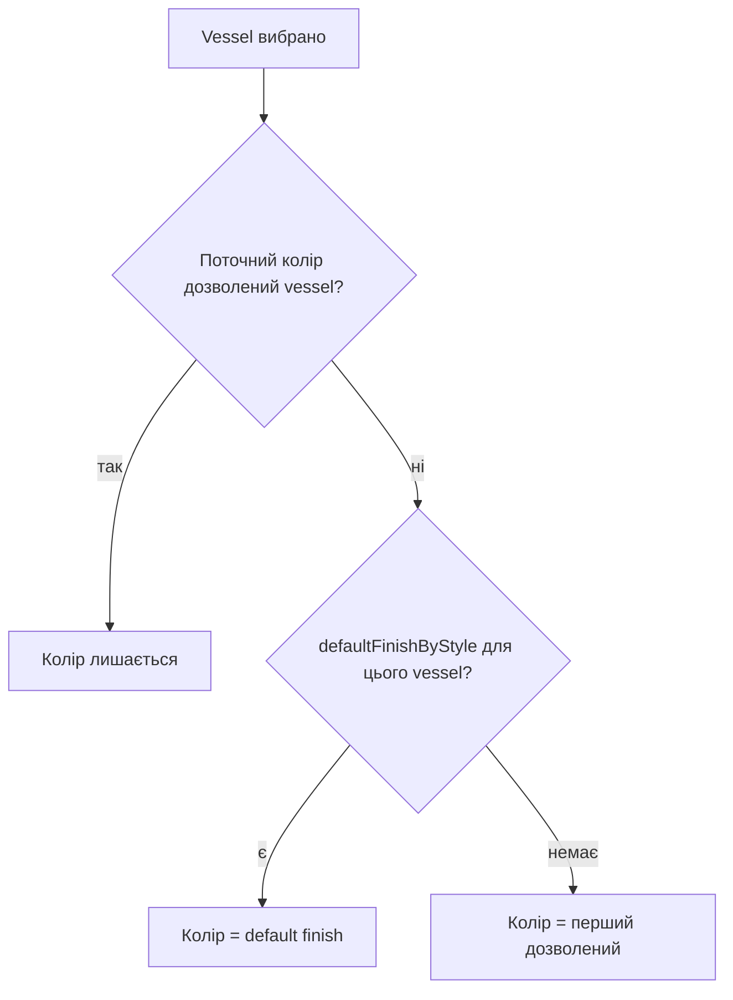

# Product integration map

Актуально для `phase-2/staging` станом на 2026-09-28. Це операційний опис того, як у застосунок
підключені Urban Standard Height (USH), Urban Low Height (ULH), Class і Mako. Документи
`docs/*-profile.md` залишаються корисними як provenance та історія рішень, але при розбіжності з ними
джерелом істини є поточні `public/collections/**` і код завантажувача.

## Коротка відповідь

Продукти не підключені чотирма окремими React-гілками. Вони є чотирма **collection packages**,
обраними через `?collectionId=`. Спільний shell завантажує пакет, нормалізує його локальні та
віддалені дані й уже з них будує навігацію, каталоги, правила, PlayCanvas-команди, SKU та ціну.

```text
URL ?collectionId
        |
        v
public/collections/registry.json
        |
        v
<collection>/manifest.json
   | local JSON                         | remote RenderAdmin
   | presets, ui, product profile,      | configurator, countertop table,
   | runtime bindings, SKU profile      | cabinet table
   +-------------------+----------------+
                       v
              loadResolvedCollection
                       |
        +--------------+----------------+
        |              |                |
        v              v                v
 dynamic routes    Redux/rules    PlayCanvas adapter + pricing
```

## Runtime pipeline

1. `ActiveCollectionProvider` один раз фіксує початковий `collectionId`. Відсутній параметр означає
   default із registry — `urban-standard-height`. Невідомий або порожній id дає контрольовану помилку.
2. `resolveCollection` знаходить manifest. Для legacy saved configuration без `collectionId` використовується
   `urban-standard-height`; явний невідомий id ніколи тихо не підмінюється USH.
3. `loadResolvedCollection` паралельно завантажує локальні файли пакета і remote sources з
   `https://renderadmin.vivid3d.tech`: `GET /configurators/:id`, `GET /datatables/:id`.
4. Loader перевіряє збіг `collectionId` між manifest, `ui.json`, `product-profile.json` і
   `runtime-bindings.json`, а також semantic coverage runtime bindings.
5. Cabinet DataTable нормалізується через `product-profile.ruleData.cabinetMatrixLegacyAdapter`;
   типи з `runtime-bindings.unplacedProductTypes` вилучаються з builder catalog.
6. `CollectionReadinessGate` не монтує configurator без remote configurator catalog. Зміна
   `collectionId` у вже відкритій SPA-сесії вимагає full-page restart.
7. `CollectionStateBridge` копіює активні profile, cabinet catalog, collection id та runtime bindings у
   Redux, де їх використовують reducers і command layer.
8. `ui.json` створює маршрути й поля. `product-profile.json` визначає допустимі значення, defaults і
   business rules. `runtime-bindings.json` перекладає semantic attributes у ключі/значення сцени.
9. Save записує `collectionId`; restore спочатку відкриває відповідну колекцію, а потім відновлює сцену.

Ключові файли коду: `src/entities/collection/lib/loadCollection.ts`,
`src/entities/collection/ui/ActiveCollectionProvider.tsx`, `src/app/router/CollectionStepRoutes.tsx`,
`src/entities/configuration/ui/CollectionStateBridge.tsx`,
`src/features/playCanvasAdapter/lib/createPlayCanvasRuntimePort.ts`.

## Матриця підключення

| Product            | `collectionId`          | Configurator | Countertop DT | Cabinet DT | Presets | Presets with composition | SKU source                    |
| ------------------ | ----------------------- | -----------: | ------------: | ---------: | ------: | -----------------------: | ----------------------------- |
| USH                | `urban-standard-height` |            4 |           438 |        439 |      54 |                       54 | legacy mappings + code series |
| ULH                | `urban-low-height`      |           10 |           589 |        580 |      59 |                       53 | `sku-profile.json`, partial   |
| Class              | `class`                 |            8 |           578 |        579 |      24 |                       24 | `sku-profile.json`, partial   |
| Mako               | `mako`                  |            9 |           577 |        581 |      42 |                       42 | `sku-profile.json`, partial   |
| Urban Freestanding | `urban-freestanding`    |           11 |           591 |        590 |      54 |                       54 | `sku-profile.json`, partial   |
| Tricot             | `tricot`                |           12 |           593 |        592 |      41 |                       41 | `sku-profile.json`, partial   |
| Urban Duplex       | `urban-duplex`          |           13 |           595 |        594 |      71 |                       66 | `sku-profile.json`, partial   |
| Lame               | `lame`                  |           14 |           597 |        596 |      43 |                       43 | `sku-profile.json`, partial   |

USH читає configurator 4. ULH читала його до 2026-11-03, а правил USH не успадковувала: власний remote id
цього не змінює.

Кожен стиль стільниці (Integrated, Vessel) отримує один вердикт із причиною від rule core
(`buildCountertopRuleState`, `styleAvailability`). Поле `CountertopStyle` показує його через
`availabilityRef: "CountertopStyle.allowed"` (прив'язано в `ui.json` кожної колекції), а vessel basins беруть
той самий вердикт, тож обидва шляхи UI дають однакові причини і композиція не може отримати vessel cutout без basin.

Urban Standard Height, Urban Low Height, Urban Freestanding і Urban Duplex вимикають Vessel (причина
`countertop.vesselSinkBaseMin`, з мінімумом у підказці), коли жоден vessel-рядок countertop table не сягає Sink Base:
рядок діє від свого `min_vsl_cm` (80 cm), і thickness під Vessel йдуть за цими самими рядками. Integrated лишається
доступним за своїми правилами table. Коли `restrictedIntegratedDepthsCm` і `restrictedIntegratedMaterialTokens`
профілю збігаються з активними глибиною та матеріалом (46 cm), відмову Integrated пояснює
`countertop.integratedDepthRestricted` замість причини рядка.

Коли стиль уже Vessel, а Sink Base стає вужчим за цей мінімум (наприклад, Resize у custom flow), стиль
скидається на перший дозволений правилами з будь-якого кроку, а басейн — на default басейн матеріалу, якщо
матриця його дозволяє, інакше на перший дозволений. Скидання чекає, поки Sink Base поставлений, не
виконується, поки vessel стоїть поза своїм Sink Base, і під час restore/undo; воно не додає крок undo. Це
спільна поведінка всіх колекцій; якщо матриця не дозволяє жодного іншого стилю, Vessel лишається.

Композиція має один басейн. Правила стільниці (кольори, thickness, басейни, vessel) судять її за найвужчим
поставленим Sink Base: ширину й глибину для них дає `useSinkBaseDimensions`, і це найвужчий Sink Base, а не
найширший. Тому на SB 80 + SB 60 Urban Duplex відмовляє HPL Strip і Cover, лишає Prisma і Quadra та відмовляє
Vessel з мінімумом у підказці; Class відмовляє Matte White 8cm (єдиний його басейн VA023 починається з 80 cm).

Підказка кольору чи integrated басейну, яким відмовляє ширина, називає потрібну ширину
(`resolveIntegratedWidthRefusal`): «Not available for current sink base width. Current 60 cm (23.6"), minimum 80 cm
(31.5").», а для рядка матриці лише з точними розмірами — їхній перелік. Колекція формулює це своїм
`countertop.sinkBaseBelowMin`; без нього діє той самий текст rule core. Відмови за глибиною, загальною довжиною чи
товщиною лишаються загальними.

Той самий хук скидає й integrated basin, який правила відмовляють, з будь-якого кроку: після скидання стилю і
після Resize чи «+» Sink Base. Приклад — Urban Duplex: HPL Strip і Cover вимагають Sink Base від 70 cm
(`min_sb_cm`), тож Strip на SB 80 після «+» 60 cm Sink Base (або зміни в сцені) отримує default басейн
матеріалу, якщо матриця його дозволяє, інакше перший дозволений (Prisma), на обох Sink Base. Вердикт дає лише
`allowedBasinKeys` rule core; хук мінімум не перераховує. Якщо жоден басейн не дозволений, басейн лишається:
Class, Matte White 8cm на SB 80, потім SB 60 — VA023 лишається, а колір показано відмовленим. Умови ті самі, що в
скидання стилю: Sink Base поставлений, sink не винесений, не restore/undo.

Вибраний vessel бере колір у тій самій команді, у всіх 8 колекціях.



Залежність належить плану команди `sinkType` (`buildChangePlan`): вона не переоцінює відновлені конфігурації
(restore, undo, replay) і не спрацьовує без поставленого Sink Base або без завантаженого configurator. Колір
отримує кожен Sink Base. Urban Duplex: Aquarius не має default finish, тож його перший сумісний колір залежить від
порядку в configurator (на live — Agata BD MT).

У колекціях Urban `ruleData.vesselCompatibility.unavailableColorCodesByStyle` читається в обидва боки. Колір
стільниці з цього списку (для Urban Modo — Porcelain TQ2) вимкнений у Countertop Color, поки обрано цей vessel
(`vessel.colorUnavailable`), а сам vessel вимкнений у Vessel Sink Style на такій стільниці
(`vessel.countertopColorUnavailable`). `allowedMaterialsByStyle` і `allowedColorCodesByStyle` судять лише власний
колір vessel. Обмеження діє тільки в UI: у Urban Freestanding, Urban Duplex і Urban Low Height його дають
schema-driven resolvers, в Urban Standard Height — legacy віджет CountertopSections; команди нічого не відмовляють.
У Urban Freestanding, Urban Duplex і Urban Low Height `autoSelect: "firstAllowed"` на `sinkType` переносить
збережений vessel, який правило відмовляє (restore, preset), на перший дозволений; Urban Standard Height такого
auto-select не має, тож збережений vessel там лишається, доки користувач його не змінить.

Зміна моделі переносить колір разом із vessel: на flat-моделі колір іде в нову сцену через `shared` та
`afterPlacement`, на compact — повторним replay. Колір, який не переноситься, очищується, щоб стан не стверджував
колір, якого нова сцена не тримає. Колекції з `prebuiltModelSelection.resetSelections` (Class) нічого не
переносять: модель скидається на integrated.

Списки ширин Sink Base у Cabinet Builder, «+» і Resize у сцені не відкидають ширини нижче `min_sb_cm` басейну:
басейн підлаштовується під шафу, а не навпаки (Urban Duplex пропонує 60–120 cm). Матеріал і модель, навпаки,
відмовляються за `min_sb_cm` у availability. «+» лишає обрану ширину, лише якщо вона є серед запропонованих
ширин, що вміщуються, інакше бере найширшу з них.

Urban Low Height має власний configurator 10 (`modular-config-phase-2 (ULH)`), а Urban Freestanding, Tricot,
Urban Duplex і Lame — material configurators 11–14 (`modular-config-phase-2-materials-(…)`), лише з кольорами
своєї колекції. Групи там звуться
`Select … Color`, а не як у configurator 4 (`Cabinet Color`, `Vessels`); код, якому потрібен вид групи
(столешниця, towel bar, swatch order, Summary), визначає його через
`src/entities/configurator/lib/configuratorGroupKind.ts`, а не за іменем.

## Ролі файлів collection package

| Файл                                      | Відповідальність                                                                                                                                                                                                           |
| ----------------------------------------- | -------------------------------------------------------------------------------------------------------------------------------------------------------------------------------------------------------------------------- |
| `manifest.json`                           | Composition root: label, defaults, локальні файли та remote ids.                                                                                                                                                           |
| `presets.json`                            | Model cards і `presetProducts`, які реально створюють композицію.                                                                                                                                                          |
| `ui.json`                                 | Prebuilt/custom flows, routes, sections, controls, image references.                                                                                                                                                       |
| `product-profile.json`                    | Attribute catalog, aliases, defaults, capabilities, rule data, reason messages.                                                                                                                                            |
| `runtime-bindings.json`                   | Product type mapping і переклад attribute values у scene patches; `state-only` та `unbound` межі; `retiredSceneValues` — перейменований scene-токен, який збережені конфігурації ще містять, → значення, що його замінило. |
| `sku-profile.json`                        | Data-driven SKU grammar для ULH/Class/Mako; `status: partial` і pricing gaps.                                                                                                                                              |
| `cabinet-sku-mappings.json`               | Legacy USH SKU mappings.                                                                                                                                                                                                   |
| `static-options.json` / `navigation.json` | Legacy USH data; для нових колекцій відповідні дані вже походять з profile/UI.                                                                                                                                             |

## Необхідні перевірки при зміні продукту

- Manifest id та всі локальні `collectionId` збігаються.
- Поле з `ui.json` існує в profile або має свідомий runtime/status contract.
- Колекція, що перейменовує scene-токен, який збережені конфігурації вже містять, лишає старий токен у
  `retiredSceneValues` binding; інакше strict-колекція (`strictProductConfig`) відхилить такі конфігурації
  під час відновлення.
- Розділ, який показує одне зі своїх полів за раз, описує `ui.json`, а не код сторінки: `fieldTabs: { label }`
  у розділі (рядок над вкладками) і `tab: { label, icon }` у кожному його полі. Urban Duplex так показує
  Panel Color: вкладки Base Panel / Lateral Panel, під ними сітка кольорів вибраної панелі. `icon` — файл
  пакета колекції 48×24 (`images/panel/*.svg`). Розділ без `fieldTabs` показує поля стопкою.
- Значення шафи, яке можна змінити лише в одній шафі, перелічує `ui.json`: `styleSidebar.attributes`
  (selector у right sidebar Cabinet Builder після власних Width / Depth / Height / Handle) і
  `playerMenu.attributes` (підменю в Details меню поставленої шафи). Для шафи, виділеної на сцені,
  змінюється лише вона; без виділення sidebar задає значення шафі, яку зараз додають. Binding такого
  attribute мусить мати `perProduct: true`, інакше колекція не завантажиться
  (`runtime.not-per-product`). Urban Duplex так показує сторону Lateral Panel, і лише так: окремого
  поля на кроці Color немає (з 27.10). Елемент списку може мати умову:
  `{ "attributeId": "LateralPanelSide", "label": "Lateral Panel", "when": { "Series": "URDPX" } }` —
  значення пропонують лише шафі, яка сама тримає ці значення (Urban Duplex: шафи інших серій панелі не
  мають). `label` — назва selector і підменю; без нього береться label розділу, що показує лише це
  поле, інакше id.
- Шафи, які колекції постачає інша серія, описує profile: `ruleData.seriesModules` — на кожну серію і тип
  шафи свої `widthsCm` і `heightsByDrawers` (Urban Duplex: Side Cabinet серій `URSTD` і `URLH`). З них
  каталог отримує варіант правила типу з полем `series`; глибини, handle і продукт сцени — від власного
  типу. Cabinet Style показує стилі групами під назвами серій (label option attribute `Series`); тип
  без варіантів лишається без заголовків. Вибір плитки кладе `Series` у config шафи: за ним binding
  шле сцені вигляд, SKU бере `bySeries`, а правила — ширини й висоти серії. `Series` записується
  в кожної шафи окремо (binding з target `product`), тому його ніколи не читають із сусідньої.
  Картинки плиток — `optionImageVariants.Drawers` з умовою `when: { "Series": … }`. Композиція має одну
  висоту: стиль, якого немає в цій висоті, перемикає всі шафи після підтвердження, а якщо поставлена
  шафа іншої серії такої висоти не має — недоступний (`drawers.notWithSeriesCabinet`); selector Height
  лишає тільки висоти, які мають усі поставлені шафи інших серій. Кожен SKU, який так можна зібрати,
  мусить мати ціну на сервері: комбінацію без ціни прибирають із `seriesModules`.
- Стиль шафи, що стоїть нижче за сусідні й має власну висоту (Urban Freestanding: Side Cabinet ▸ 1 Drawer
  Short), описують: таблиця шаф (`drawer_configs` 1DW і його `forced_height_cm` — розмір і висота
  для SKU), profile `ruleData.steppedModules` (тип, стиль, `placement: composition-end`, категорія шафи, яка
  потрібна першою). Висоти stepped-стилю каталог не форсує, а переносить у `steppedHeightByHandle`
  (`matrixCabinet` `withSteppedModules`); з них `buildSteppedSceneProducts` складає для `sceneBridge` scene
  type, значення, за якими сцена впізнає коротку шафу (через bindings), і висоту за handle. Композиція
  лишається на висоті інших шаф, а `sceneBridge` ставить і після кожної команди з `Height`/`Handle` повертає
  короткій шафі власну висоту. Висоти в JSON колекції не дублюються. Деталі —
  [`../urban-freestanding-short-cabinet.md`](../urban-freestanding-short-cabinet.md).
- Кожен core/UI attribute покритий binding зі статусом `bound`, `state-only` або `unbound`.
- Cabinet table читається через mapping саме цього profile; не додавати USH fallback.
- Висоту, яку користувач обирає сам (selector Height у right sidebar і Resize ▸ Height у меню шафи),
  дає profile: `cabinetMatrixLegacyAdapter.columns.heightsByHandle` — висоти кожного handle з колонок
  таблиці (Urban Low Height), або `cabinetMatrixLegacyAdapter.heightsByDrawers` — висоти стилю шухляд,
  коли таблиця форсує для нього одну (Urban Duplex: `"1": [53, 38, 28]`, бо table 594 каже `1DW:53`,
  а 1DW продається ще й як Slim 38 і 28 cm). Полиця без handle і шухляд ділить висоту композиції:
  Urban Low Height Open Shelf бере `heightsByHandle` поставлених шаф (`resolveHeightsByHandle`), Urban
  Duplex Open Shelf і Open Side Shelf — висоти, спільні для шухляд поставлених шаф
  (`resolvePlacedDrawerHeights`: поруч з 1DW — 53/38/28, поруч з 2DW чи 1DWID вибору немає). Сцена
  v74 не знає висоти 38 для Open Side Shelf (`RuleHeightUDOpenShelvesSide`: `[56, 53, 28]`), тож на
  15″ та лишає попередній меш, хоч би де висоту обрали. Обидва місця вмикає `ui.json` (`styleSidebar.fields`,
  `playerMenu.resize`); висоту нової композиції задає `defaultValue` attribute `Height`. Стиль, якого
  немає у висоті вже поставлених шаф (Urban Duplex: 1DWID поруч зі Slim), перемикає їх усі після
  підтвердження — так само, як стиль іншої групи `drawerStyleGroups`.
- Product type існує в `productTypes` або свідомо прихований у `unplacedProductTypes`. Тип переноситься
  в `productTypes` лише після того, як сцена реєструє його продукт (`sceneKeysInExport.test.ts`
  перевіряє це для Urban Freestanding і Urban Duplex): на невідомий тип сцена відповідає порожньою
  заглушкою.
- `optionsSource: configurator:<group>` точно збігається з `proxyName` remote configurator group;
  `configurator:<group>/<option>` бере лише одну option цієї групи (Urban Duplex:
  `Select Cabinet Colors/Base Panel` і `…/Lateral Panel`). Якщо attribute має ще й власні `options`
  (Tricot), вони лишаються allowlist: configurator додає до них hex, SKU і картинки, але не нові кольори.
- Новий preset має валідний image path і, якщо він повинен будувати сцену, непорожній `presetProducts`.
- Pricing не позичає SKU series іншого продукту.
- `collectionId` зберігається у всіх route links, save metadata та restore URL.

## Продуктові документи

Специфікація кожної колекції — тека `docs/products/<id>/` (8 файлів за розділами специфікації від 2026-10-28 + `integration.md`, де була окрема сторінка); вхід — `README.md` теки. Статуси — [`_shared/status-legend.md`](_shared/status-legend.md), назви кольорів — [`_shared/palettes.md`](_shared/palettes.md).

- [Urban Low Height](urban-low-height/README.md) — специфікація + [інтеграція в код](urban-low-height/integration.md) (головний робочий контекст).
- [Urban Standard Height](urban-standard-height.md) — лише робочий контекст; специфікації ще немає.
- [Class](class/README.md) — специфікація + [інтеграція в код](class/integration.md).
- [Mako](mako/README.md) — специфікація + [інтеграція в код](mako/integration.md).
- [Urban Duplex](urban-duplex/README.md) — специфікація + [інтеграція в код](urban-duplex/integration.md).
- [Urban Freestanding](urban-freestanding/README.md) — специфікація.
- [Tricot](tricot/README.md) — специфікація.
- [Lame](lame/README.md) — специфікація.
